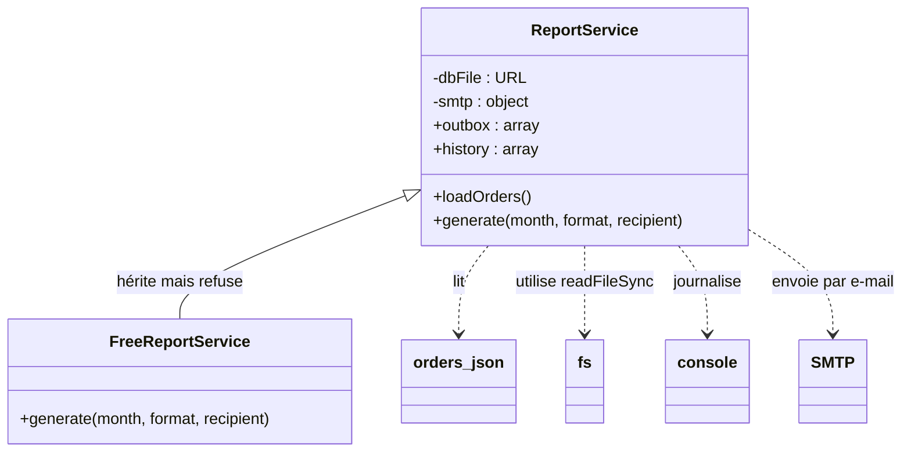
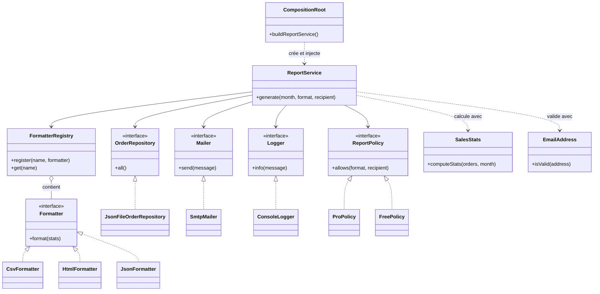

# TP 3 : Diagrammes de classes (parcours Data)

## Avant : l'existant

`ReportService` dépend directement du fichier, de la console et du serveur SMTP, et `FreeReportService` hérite de lui pour refuser une partie de ce qu'il accepte.

## Après : la cible

Dans la cible, chaque responsabilité a sa classe : calcul (`SalesStats`), validation (`EmailAddress`), formats (un `Formatter` par format dans un registre), lecture, envoi et journal (interfaces avec une implémentation technique). `ReportService` ne dépend que d'interfaces et de la politique d'accès. L'offre gratuite devient une `FreePolicy` injectée au lieu d'une sous-classe, ce qui règle la violation de Liskov. Seule la `CompositionRoot` crée les objets concrets.
